# SOFT TENNIS NOTE

> 練習を記録して、うまくなる。ソフトテニスの成長が見える練習ノート


## アプリケーション概要

SOFT TENNIS NOTEは、練習内容や気づきを記録し、選手と指導者、保護者などの関係者で共有するアプリ。

練習の振り返りを通じて課題を見つけ、次の練習に生かすことを目指す。


## 開発した背景・理由

練習ノートを使っていても、記録を見たり評価したりする人が限られていると、選手が何を考えて練習しているのか、周りの人に伝わりにくいことがある。

そこで、選手だけでなく指導者や保護者など、関わる人が練習の記録を確認できるアプリを作成。選手が一人で悩まず、周りの人と課題や成長を共有できる場にしたい。


### 工夫した点

---

爽やかなデザイン。

記録を続けやすいよう、画面はシンプルにし、入力項目も必要なものに絞った。

練習内容を細かく書き残すことよりも、練習中に気づいたことや次に試したいことを、気軽に記録できるようにした。  


### 苦労した点と解決方法

---

画面の段組みや、情報を見やすく配置するところに苦労した。

実際に画面を確認しながら調整を重ね、使いやすさと見た目のバランスを整えた。

## 主な機能

- CSRFトークンの取得
- アカウント登録、ログイン、ログアウト
- ログイン中の利用者情報の取得
- 練習記録の一覧表示、詳細表示
- 練習記録の登録、編集、削除
- 選手・指導者と保護者・関係者で異なる権限

## デモ画面

> 01＿ログイン画面【共通】

★ 初回時は「初めて使う方はアカウント作成」をクリック（02へ）  
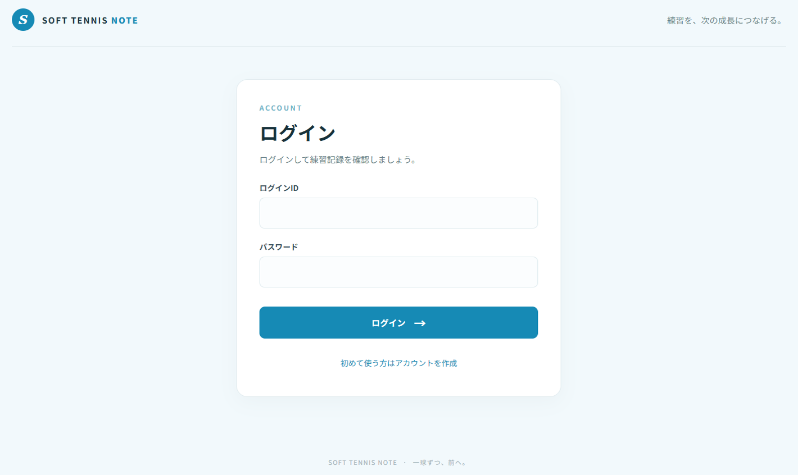

> 02＿アカウント作成画面【共通】

★ 各項目を入力（任意の内容でOK）  
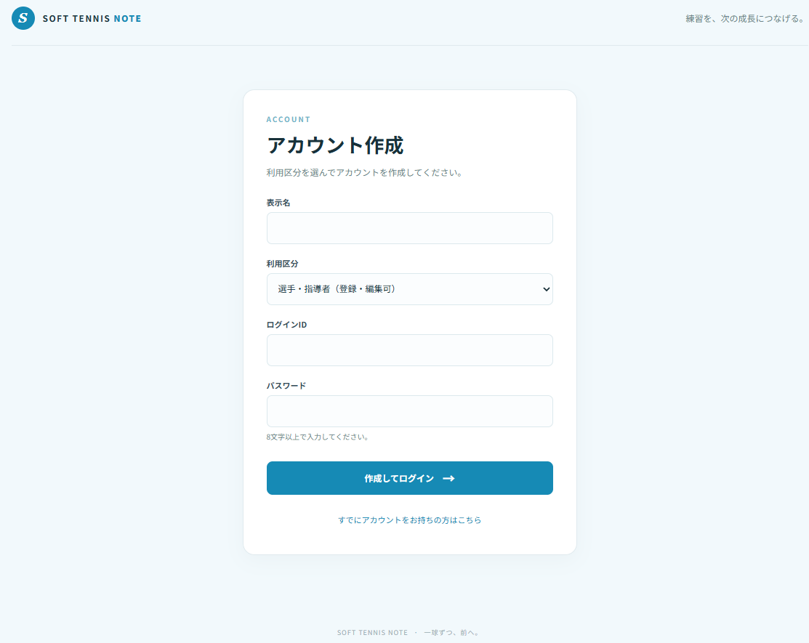

★ ここで利用区分を確認。この登録内容で利用権限を判別    
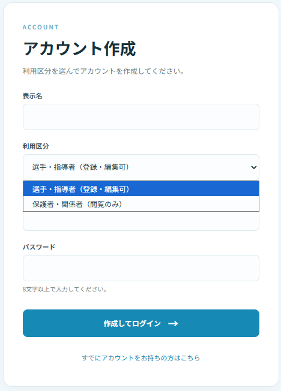  

★ 「すでにアカウントをお持ちの方はこちら」から、登録不要の際の戻るボタン設置。  

★ 選手・指導者（登録・編集可）で登録・ログインした場合は03へ  
★ 保護者・関係者（閲覧のみ）で登録・ログインした場合は04へ

> 03＿選手・指導者（登録・編集可）

★ 画面上部右上に「編集可能」という文字が表示される。  
　 「練習を登録」ボタンと一覧部分に「編集・削除」が表示される。  
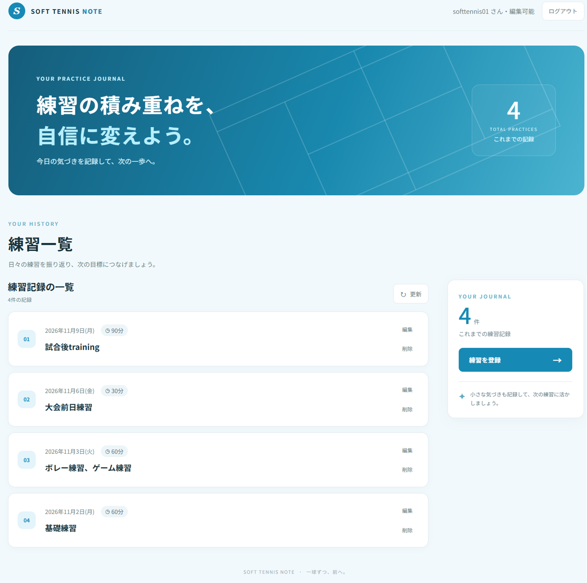  

★ 「練習を登録」から必要事項を入力し、記録を保存。  
 　入力が完了したら「記録を保存」をクリック  
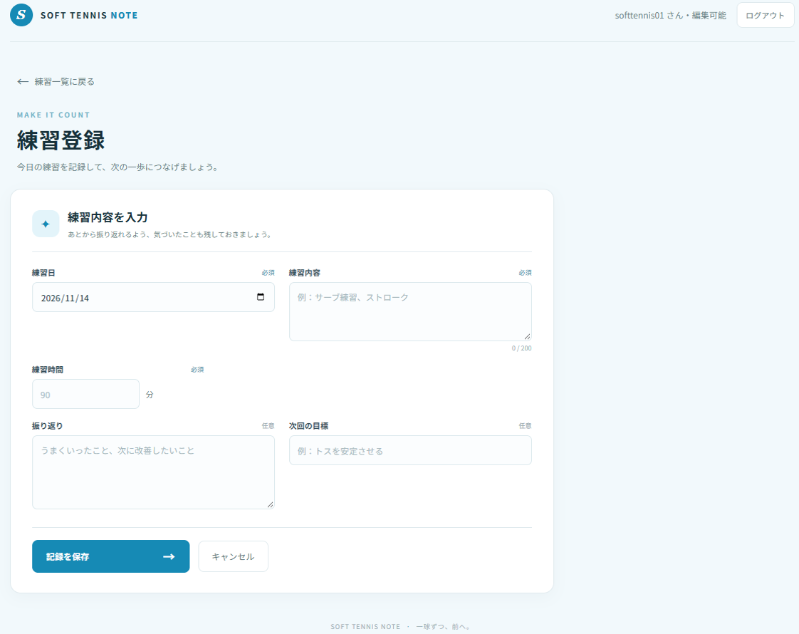  

★ 一覧画面に戻り「練習記録を保存しました。」が表示される。  
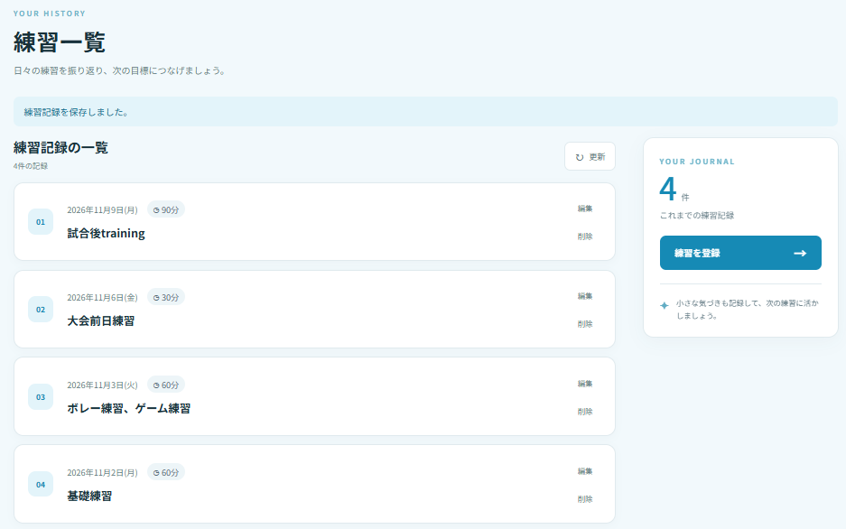  

※「練習記録を保存しました。」の画面表示については5秒後に消えるように設定。

★ 一覧で見たい練習をクリックすると詳細が表示される。  
　 「この記事を編集」ボタンが表示される。  

 　一覧へ戻りたい場合は「一覧へ戻る」または「練習一覧に戻る」をクリック  

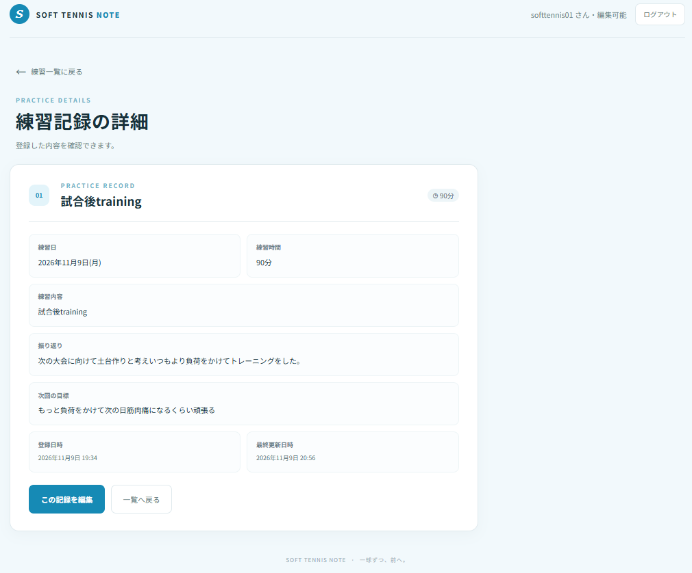  

★ 「この記事を編集」する場合は「この記事を編集」ボタンをクリック  

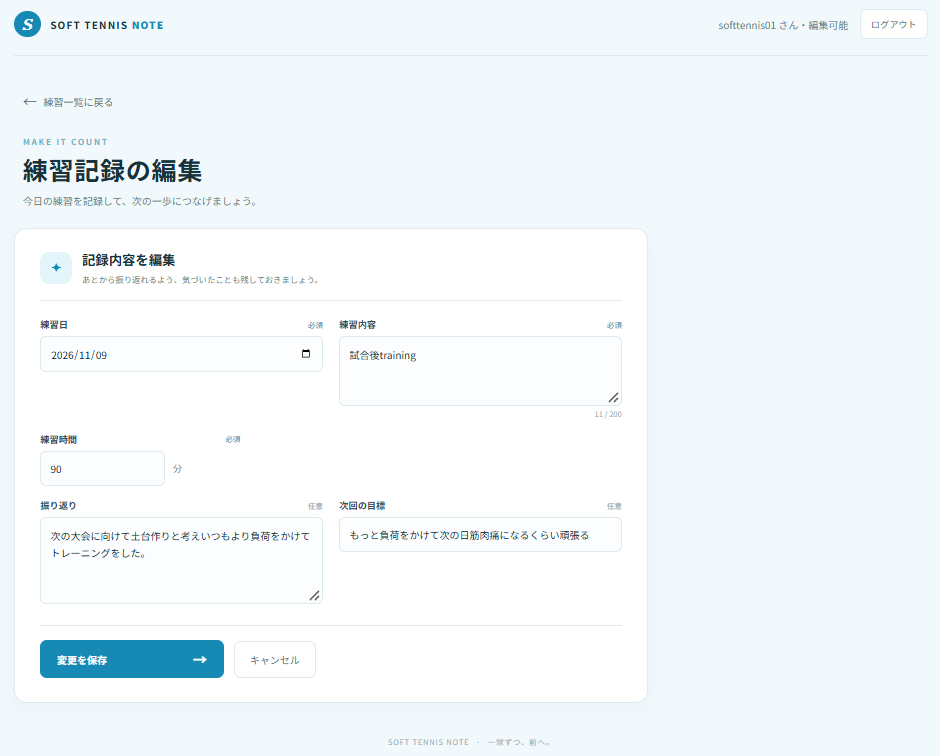  

★ 編集が終わったら「変更を保存」をクリック  
　 一覧画面に戻り「練習記録を更新しました。」が表示される。  

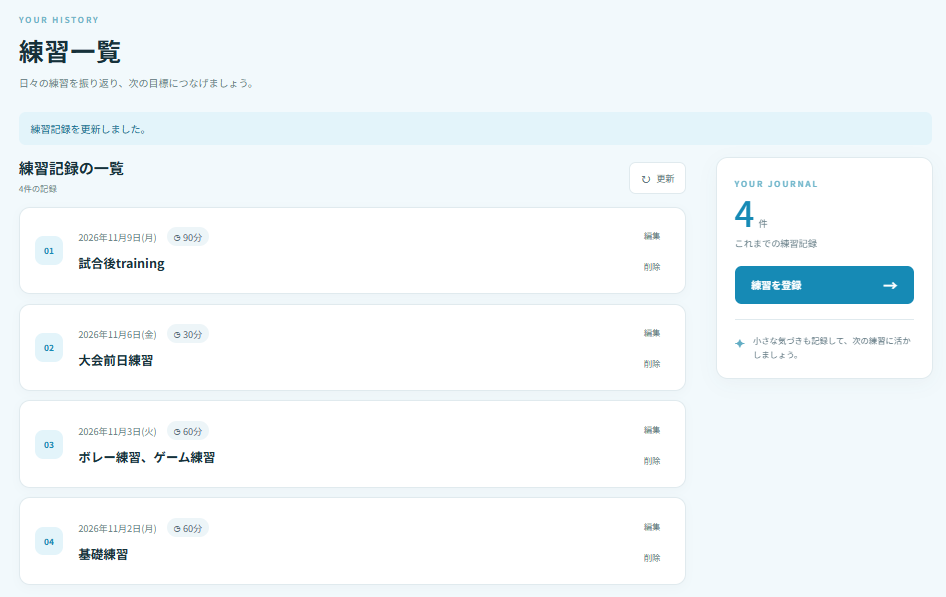

※「練習記録を更新しました。」の画面表示については5秒後に消えるように設定。

> 【補足】選手・指導者（登録・編集可）削除時の画面表示

★ 削除したい練習記録の「削除」ボタンをクリック  

  

★ 画面中央上部に【「練習内容」の記録を削除しますか？】のポップアップが表示される。  
　 「OK」を押下。  

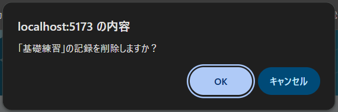  

★ 一覧画面に戻り「練習記録を削除しました。」が表示される。  

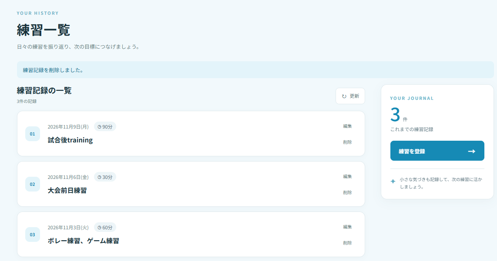  

※「練習記録を削除しました。」の画面表示については5秒後に消えるように設定。

> 04＿保護者・関係者（閲覧のみ）

★ 画面上部右上に「閲覧のみ」という文字が表示される。  
　 「練習を登録」ボタンと一覧部分の「編集・削除」は非表示。  

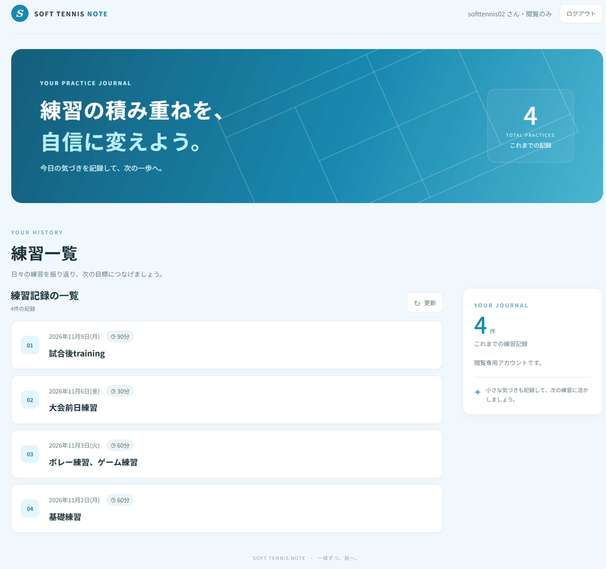  

★ 一覧で見たい練習をクリックすると詳細が表示される。  
　一覧へ戻りたい場合は「一覧へ戻る」または「練習一覧に戻る」をクリック  
　 「この記事を編集」ボタンは非表示。  

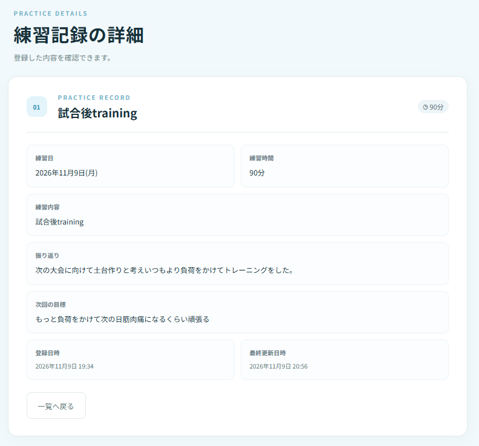

> 05＿ログアウト【共通】

★ 画面右上の「ログアウト」ボタンを押下
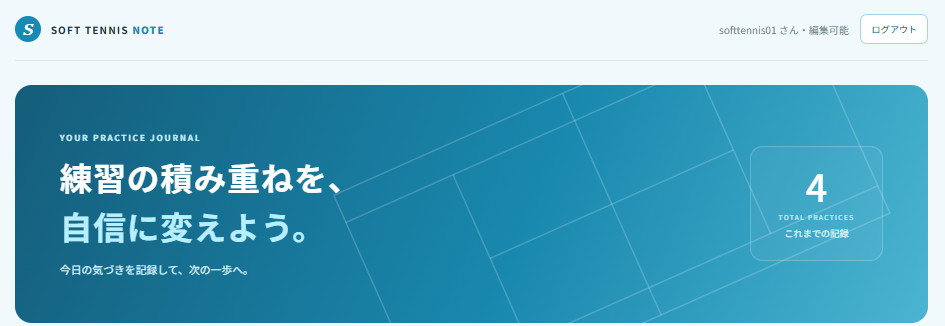

★ ログイン画面に戻る（ログインIDはログインしていたものが残る）
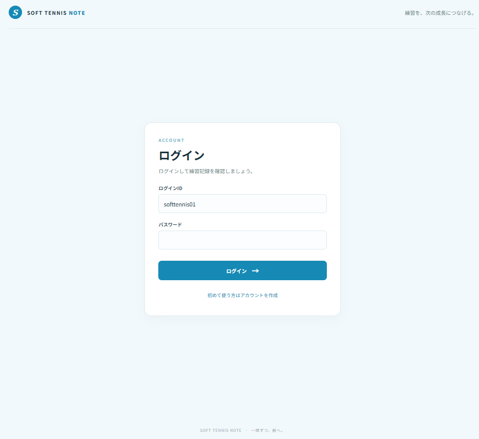

## 使用技術

- フロントエンド：React、Vite
- バックエンド：Java、Spring Boot、Spring Security
- データベース：ローカル開発ではMySQL、本番環境ではNeon PostgreSQL
- インフラ：Vercel、Render、Neon
- ローカル開発環境：Docker Compose

## ER図

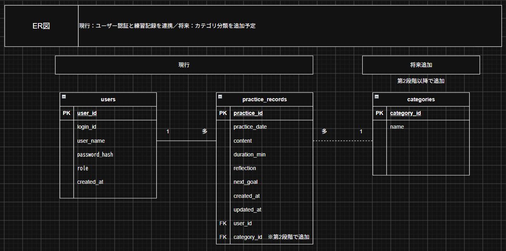

## インフラ構成図

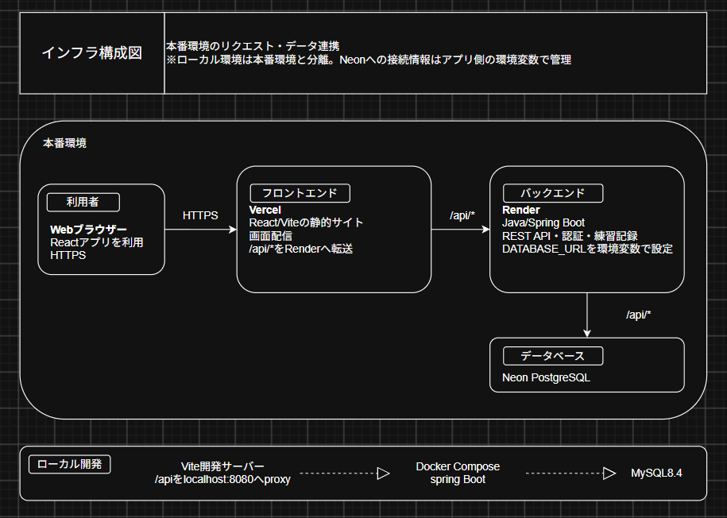

## ローカル環境での起動方法

## セットアップ 

### 必要環境

- Docker Desktop（Docker Composeが使えること）
- Node.js 22.23.4
- npm 10.9.9
- Java 21（バックエンドをDockerを使わずに起動する場合）

### 1.GitHubからリポジトリをクローンする
```powershell
git clone https://github.com/sasaki-mzk888/practice-note.git
cd practice-note
Copy-Item backend/.env.example backend/.env
```

### 2.`backend/.env.example` を `backend/.env` にコピーして設定する
Docker Desktopを起動してから、`backend/.env.example`を参考に`backend/.env`を作成し、ローカル環境用の値を設定する。

### 3.Docker Composeでデータベースとバックエンドを起動する
```powershell
cd backend
docker compose up -d --build
```

### 4. フロントエンドを起動する
別のPowerShellを開いて、プロジェクトのルートから次を実行する。
```powershell
cd frontend
```
初回のみ、依存パッケージをインストールする。
```powershell
npm install
```
開発サーバーを起動。
```powershell
npm run dev
```

ブラウザーでローカルURL（http://localhost:5173）を開く。

### 5. アカウント作成
初回はログイン画面の「初めて使う方はアカウントを作成」から、アカウントを登録すること。  
動作を確認する場合、次の2種類のアカウントを作成する。
ログイン画面が開くので、初回は自分で「初めて使う方はアカウントを作成」から以下2つのアカウントを作成する。
- 選手・指導者（登録・編集可）：練習記録の登録や編集ができる。
- 保護者・関係者（閲覧のみ）：練習記録を閲覧できる。

### スマートフォンでの確認方法

PCとスマートフォンを同じWi-Fiに接続。  
`frontend`設定で次のコマンドを実行する。
```powershell
npm run dev -- --host 0.0.0.0
```
PCで`ipconfig`実行してIPv4アドレスを確認し、スマートフォンで`　http://PCのIPv4アドレス:5173/　`を開く

### 停止方法

`backend` フォルダーで次のコマンドを実行する。

```powershell
docker compose down
```
## 注意事項

- ローカル開発用の設定値は`backend/.env`に記入すること。パスワードなどの値をGitHubに公開しないよう注意すること。
- `docker compose down`では、データベースの保存領域は削除されない。
